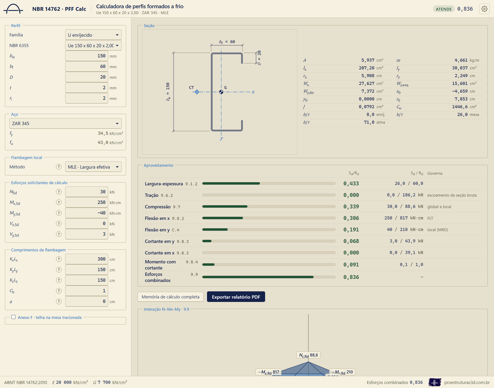
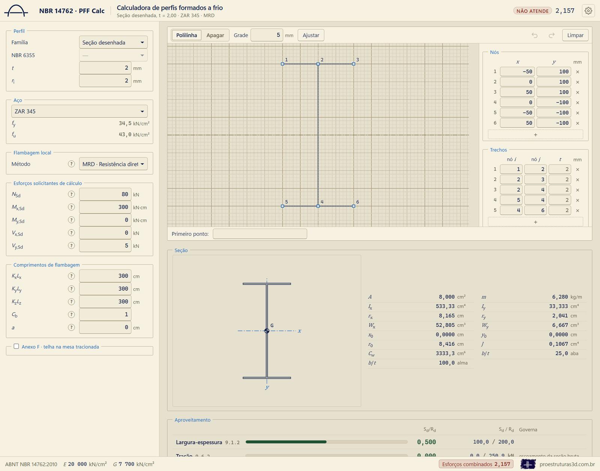
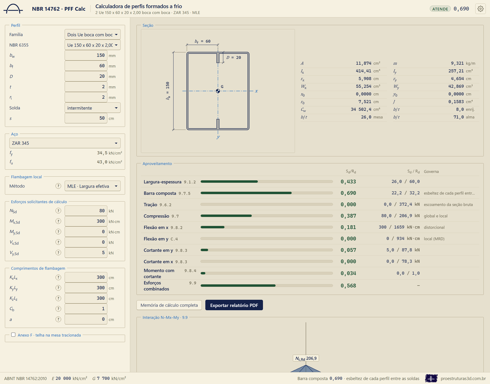
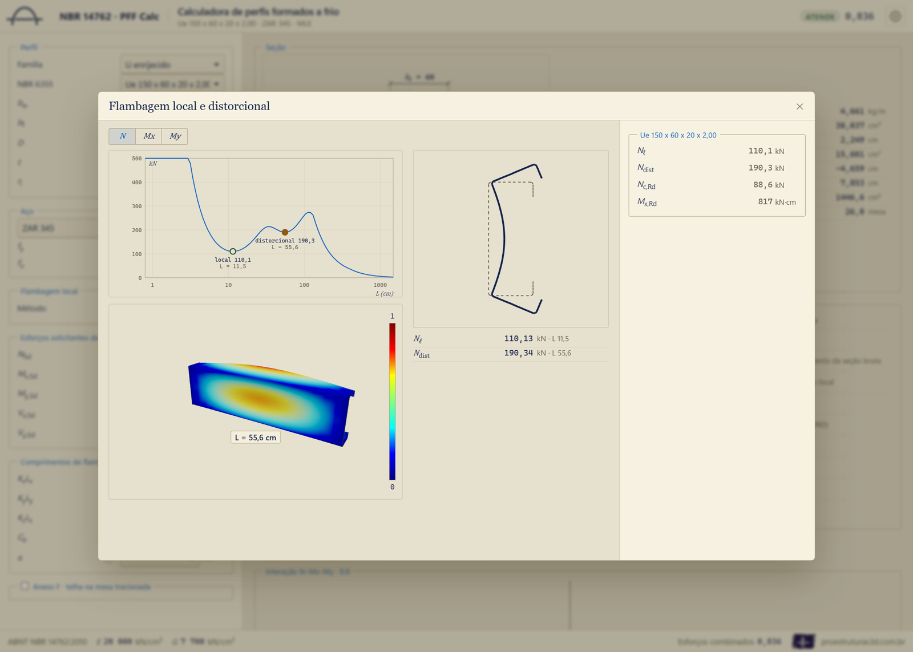
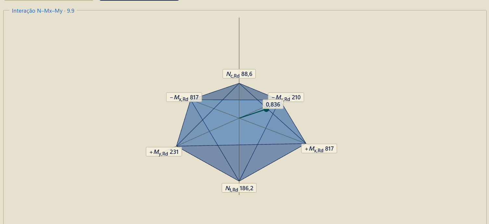
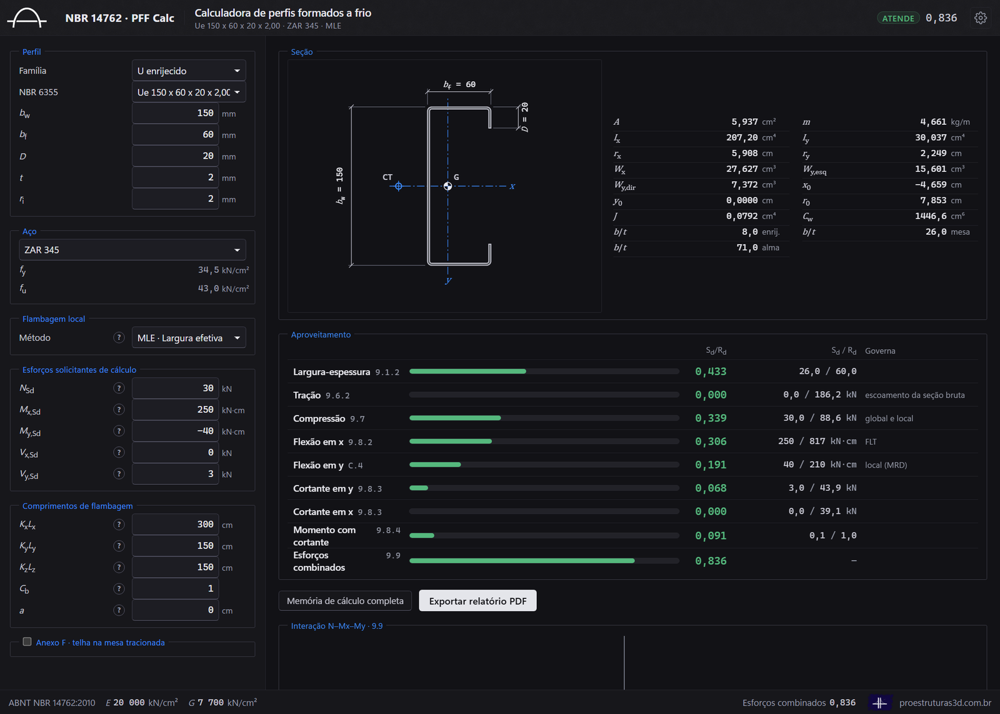

# PFF Calc

A PFF Calc verifica barras de perfil formado a frio pela ABNT NBR 14762:2010: calcula os esforços críticos elásticos por um método das faixas finitas próprio, trata a flambagem local pelos três métodos da norma (largura efetiva, seção efetiva e resistência direta) e entrega a memória de cálculo completa, com cada fórmula, os números no lugar das letras e o item da norma.

## O que verifica

Uma barra isolada sob os esforços solicitantes de cálculo informados pelo engenheiro: força normal, momentos fletores nos dois eixos e forças cortantes nos dois eixos. São verificados os limites de largura-espessura, a tração, a compressão (global, local e distorcional), a flexão nos dois eixos (escoamento da seção efetiva, flambagem lateral com torção e distorcional), a força cortante, o momento com cortante, os esforços combinados e, quando escolhido, a terça com telha pelo Anexo F.

As famílias são o U, o U enrijecido, o Z, o Z enrijecido (a 90° ou a 45°), a cartola e as cantoneiras, além da seção desenhada pelo engenheiro e de dois U enrijecidos soldados boca com boca.

O manual completo, com o que fica de fora, as decisões onde a norma é omissa e as conferências contra outros programas, está em [docs/MANUAL.pdf](docs/MANUAL.pdf).

## Baixar e instalar

**Com o instalador.** Baixe o `PFF Calc Setup` em [github.com/josebarbalho25-lang/PFF-Calc/releases/latest](https://github.com/josebarbalho25-lang/PFF-Calc/releases/latest) e dê dois cliques. A instalação é por usuário, sem senha de administrador, e deixa atalhos no menu Iniciar e na área de trabalho. O instalador não tem assinatura digital: se o Windows mostrar "O Windows protegeu o computador", clique em "Mais informações" e depois em "Executar assim mesmo".

**Sem instalador.** Baixe esta pasta (botão "Code", "Download ZIP"), instale o [Node.js](https://nodejs.org) na versão 20 ou mais recente e dê dois cliques em `ABRIR.bat`. Na primeira vez, ele mostra o termo de responsabilidade e instala as bibliotecas; depois, o navegador abre em `http://localhost:5190`.

## Telas

| | |
| --- | --- |
|  |  |
| O editor da seção desenhada | Dois U enrijecidos boca com boca |
|  |  |
| O modo de flambagem na barra, em 3D | O diagrama de interação N–Mx–My |
|  | |
| O tema Escuro | |

## Licença, termo e contato

A PFF Calc é distribuída sob a licença MIT ([LICENSE](LICENSE)): pode ser usada, copiada e modificada livremente, desde que o autor, José Barbalho, seja citado. O uso está sujeito ao [termo de responsabilidade](TERMO-DE-RESPONSABILIDADE.md): a calculadora é uma ferramenta de apoio, e a responsabilidade pela verificação é do engenheiro que assina o projeto.

Site: [proestruturas3d.com.br](https://proestruturas3d.com.br)

Dúvidas, críticas ou sugestões: contato@proestruturas3d.com.br
