# PFF Calc — Manual do usuário

Perfis de aço formados a frio, pela ABNT NBR 14762:2010. Versão 0.1.0, novembro de 2026.

## O que a calculadora verifica e o que fica de fora

A PFF Calc é a calculadora de Perfil Formado a Frio pela ABNT NBR 14762:2010: o nome junta a sigla do perfil e a palavra calculadora. Ela verifica uma barra isolada de perfil formado a frio sob os esforços solicitantes de cálculo que o engenheiro informa: força normal, momentos fletores nos dois eixos e forças cortantes nos dois eixos. Ela não faz análise estrutural; os esforços vêm do modelo do engenheiro (SAP2000, TQS, A-PORT ou outro), já majorados, e a calculadora devolve as resistências de cálculo, o índice de aproveitamento de cada estado-limite e a memória de cálculo completa.

### Perfis

As famílias parametrizadas, com as dimensões externas da ABNT NBR 6355 digitadas em milímetros, são:

- U simples (U) e U enrijecido (Ue);
- Z simples (Z) e Z enrijecido (Ze), com o enrijecedor a 90° ou a 45°;
- cartola (Cr);
- cantoneira simples (L) e cantoneira enrijecida (Le).

Os perfis padronizados da NBR 6355 estão num catálogo de atalho: escolher um perfil preenche os campos, e qualquer campo pode ser alterado depois, o que transforma a escolha em perfil livre.

Além das famílias, há duas formas de seção que não seguem uma figura fixa:

- **Seção desenhada.** O engenheiro desenha a linha média da chapa com nós e trechos, e a seção pode ramificar (um I, um T), fechar uma célula (uma caixa) e ter trechos de espessuras diferentes. A resistência sai pelo método da resistência direta (MRD), com os esforços críticos das faixas finitas.
- **Dois Ue boca com boca.** Dois perfis U enrijecidos com as pontas dos enrijecedores encostadas. Com solda contínua, a seção é tratada como tubo retangular fechado; com solda intermitente, como barra composta pelo item 9.7.5, com o espaçamento das soldas informado.

### Aços

Todos os aços da Tabela 1 da norma (NBR 6649, NBR 5004, NBR 5920 e NBR 7008, incluindo os ZAR), o aço sem qualificação estrutural do item 4.2 (resistência ao escoamento de 18 kN/cm² e à ruptura de 30 kN/cm²) e a opção "Outro", em que o engenheiro digita a resistência ao escoamento e a resistência à ruptura. O módulo de elasticidade é 20 000 kN/cm² e o módulo de elasticidade transversal, 7 700 kN/cm².

### Estados-limites verificados

| Verificação | Item da norma |
| --- | --- |
| Limites de largura-espessura | 9.1.2, Tabela 4 |
| Barra composta (dois Ue com solda intermitente) | 9.7.5 |
| Tração | 9.6.2 |
| Compressão: flambagem global por flexão, torção ou flexo-torção; flambagem local; flambagem distorcional | 9.7 |
| Flexão em torno de x e de y: início de escoamento da seção efetiva; flambagem lateral com torção; flambagem distorcional | 9.8.2 |
| Força cortante nas duas direções | 9.8.3 |
| Momento fletor com força cortante | 9.8.4 |
| Esforços combinados | 9.9 |
| Barra com painel conectado à mesa tracionada (terça com telha), quando escolhido | Anexo F |

A flambagem local é tratada pelos três métodos da norma, à escolha do engenheiro: o método da largura efetiva (MLE), o método da seção efetiva (MSE) e o método da resistência direta (MRD, Anexo C).

### O que fica de fora nesta versão

Ficam de fora: as ligações (seção 10, incluindo o dimensionamento da própria solda dos dois Ue), as forças concentradas na alma (Anexo D), os furos na seção, o efeito do trabalho a frio no aumento da resistência ao escoamento, a viga mista (Anexo G) e a cantoneira fletida nos eixos principais de inércia. A norma usada é a edição de 2010, e só ela: nenhuma fórmula, coeficiente ou limite vem de outra norma ou de outra edição.

## Como instalar e abrir

A PFF Calc pode ser usada de dois jeitos: instalada, como qualquer programa do Windows, ou sem instalação, rodando no navegador a partir da pasta baixada do GitHub. As contas, a tela e a memória de cálculo são as mesmas nos dois.

### Com o instalador

O instalador, `PFF Calc Setup 0.1.0.exe`, está no site proestruturas3d.com.br e na página de versões do repositório PFF-Calc no GitHub (github.com/josebarbalho25-lang/PFF-Calc).

1. Dê dois cliques no instalador. A primeira tela é o termo de responsabilidade; a instalação só segue depois do aceite.
2. A instalação é por usuário: vai para a pasta de programas do próprio usuário e não pede senha de administrador.
3. Ao terminar, ficam atalhos no menu Iniciar e na área de trabalho, e o programa pode ser aberto na última tela do instalador.

O programa abre numa janela própria, funciona sem internet e não precisa do Node.js. O PDF da memória sai pelo próprio programa, com a caixa "Salvar como" do Windows. Os links externos, como o do site no rodapé, abrem no navegador padrão.

O instalador não tem assinatura digital. Por isso, na primeira vez que ele for aberto depois de baixado, o Windows pode mostrar o aviso "O Windows protegeu o computador": clique em "Mais informações" e depois em "Executar assim mesmo".

Para desinstalar, use "Aplicativos instalados", nas configurações do Windows. O desinstalador remove o programa, os atalhos e também o que a calculadora guarda: a última entrada, o tema e o projetista.

### Sem instalador, pelo GitHub

A pasta do repositório PFF-Calc roda no navegador, servida pela própria máquina. É preciso ter o Node.js instalado, na versão 20 ou mais recente. Depois disso:

1. Abra a pasta da calculadora e dê dois cliques em `ABRIR.bat`.
2. Na primeira vez, o arquivo mostra o termo de responsabilidade, que pede o aceite, e instala as bibliotecas, o que leva um ou dois minutos.
3. O navegador abre sozinho em `http://localhost:5190`. A janela preta que fica aberta é o servidor da calculadora: enquanto ela estiver aberta, a calculadora funciona.

Nos dois jeitos, a última entrada fica guardada, e a calculadora reabre onde parou. Os prints deste manual estão no tema papel, que é o melhor para imprimir; o escuro é o de abertura.

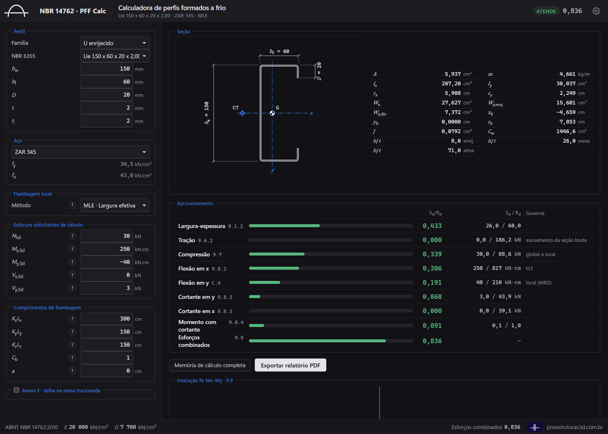

### Termo de responsabilidade

A calculadora é uma ferramenta de apoio ao projeto. A responsabilidade pela concepção estrutural, pela obtenção dos esforços, pela escolha das hipóteses e pela verificação final é do engenheiro que assina o projeto. A memória de cálculo mostra cada fórmula com os números substituídos, justamente para que o engenheiro confira o resultado antes de assiná-lo. O texto completo do termo está no arquivo `TERMO-DE-RESPONSABILIDADE.md`, que acompanha o programa; é o mesmo que o instalador e o `ABRIR.bat` mostram antes do aceite.

## A tela, campo por campo

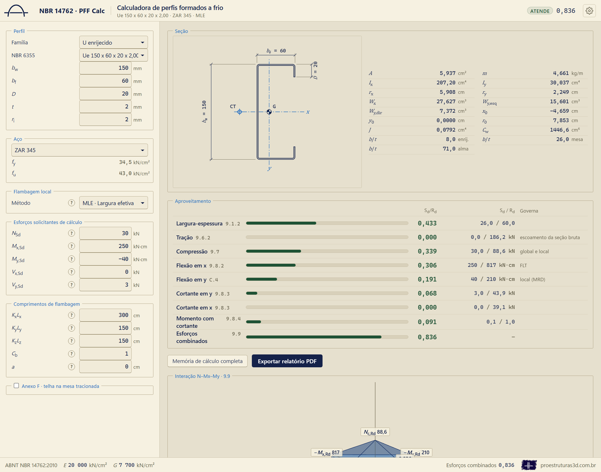

A coluna da esquerda reúne as entradas; a da direita, a seção desenhada em escala com o centroide (G) e o centro de torção (CT), as propriedades geométricas, o quadro de aproveitamento e o diagrama de interação. No alto, ao lado do nome, ficam a situação geral, o índice máximo e a engrenagem da configuração. A barra de estado, embaixo, mostra a verificação que comanda e o índice dela, e termina no link do site proestruturas3d.com.br.

### Configuração

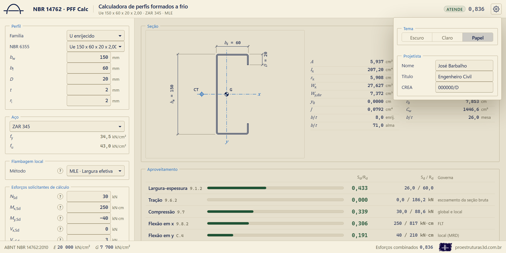

A engrenagem, no canto superior direito, abre a configuração, que tem duas partes:

- **Tema.** Escuro, Claro ou Papel. A troca repinta a tela inteira, inclusive as cenas 3D; a memória de cálculo não muda com o tema.
- **Projetista.** Nome, título (por exemplo, "Engenheiro Civil") e o registro no CREA (Conselho Regional de Engenharia e Agronomia). Esses dados vão para o carimbo e para a assinatura da memória de cálculo.

A configuração é gravada na hora, sem botão de salvar, e fica guardada para as próximas vezes. Ela fecha com Esc ou com um clique fora dela.

### Perfil

- **Família e NBR 6355.** A família e, se for o caso, o perfil do catálogo.
- **bw, bf, D, t, ri.** Altura da alma, largura da mesa, altura do enrijecedor, espessura e raio interno de dobramento, todos em milímetros e todos dimensões externas. O raio interno padrão é igual à espessura.
- **θ** (Z enrijecido). O ângulo do enrijecedor, 90° ou 45°. No enrijecedor inclinado, o D é medido ao longo do enrijecedor, do prolongamento da face externa da mesa até a ponta, como na Figura 2 da norma.
- **Cartola.** O bw é a altura das paredes e o bf a largura da mesa de cima, na mesma ordem das outras famílias: "Cr 100 x 50" tem paredes de 100 mm. O D vai da face externa da parede até a ponta do enrijecedor.
- **Solda** (dois Ue). Contínua ou intermitente; na intermitente, o espaçamento s entre as soldas, em centímetros.

### Aço

O aço da lista mostra a resistência ao escoamento (fy) e a resistência à ruptura (fu) da Tabela 1. Com "Outro", os dois valores são digitados.

### Flambagem local

O método da flambagem local: largura efetiva (MLE), seção efetiva (MSE) ou resistência direta (MRD). Onde o método escolhido não se aplica (por exemplo, o MLE na seção desenhada ou na nervura soldada dos dois Ue), a calculadora usa o MRD e diz isso na memória.

### Esforços solicitantes de cálculo

- **NSd**, em kN: positivo comprime, negativo traciona.
- **Mx,Sd e My,Sd**, em kN·cm. O momento positivo comprime o lado positivo do eixo perpendicular: Mx positivo comprime a mesa de cima; My positivo comprime o lado das pontas das mesas no U e no Ue.
- **Vx,Sd e Vy,Sd**, em kN.

No Z e na cantoneira, os esforços entram nos eixos da alma e das abas, que são os eixos do modelo estrutural; a conversão para os eixos principais de inércia, onde a norma pede, é feita por dentro e aparece na memória.

### Comprimentos de flambagem

- **KxLx, KyLy e KzLz**, em centímetros: os comprimentos efetivos de flambagem por flexão em torno de x, por flexão em torno de y e por torção.
- **Cb**: o fator de modificação para momento fletor não uniforme da flambagem lateral com torção. A janela do (?) calcula o Cb pelo diagrama de momentos.
- **a**: a distância entre enrijecedores transversais da alma, para a força cortante. Com zero, a alma é tratada como sem enrijecedores transversais.

### Anexo F, a terça com telha

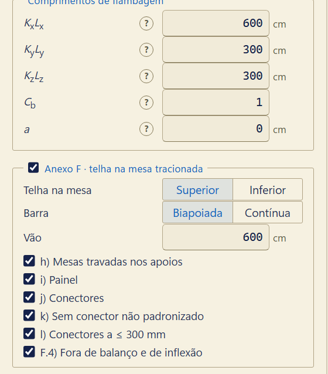

O bloco "Anexo F · telha na mesa tracionada", embaixo dos comprimentos, liga a verificação da flexão em x pelo Anexo F da norma: a barra com um painel (a telha de aço) conectado à mesa tracionada e a mesa comprimida sem travamento lateral, como a terça sob o vento de sucção. Ligado, o bloco pede:

- **Telha na mesa.** Superior ou inferior: a mesa que recebe o painel.
- **Barra.** Biapoiada ou contínua.
- **Relação entre vãos.** Só na barra contínua: a relação entre vãos adjacentes, que decide a linha da Tabela F.1.
- **Vão**, em centímetros.
- **As condições declaradas.** As que dependem da obra e que a calculadora não tem como conferir, cada uma marcada pelo engenheiro: f) o traspasse de pelo menos 1,5·bw de cada lado do centro dos apoios internos, só na barra contínua; h) o deslocamento lateral das duas mesas impedido nos apoios; i) o painel; j) os conectores; k) nenhum conector não padronizado; l) os conectores espaçados de no máximo 300 mm, perto do centro da mesa; e o F.4: a barra não está em balanço nem num trecho entre um ponto de inflexão e o apoio vizinho. O texto completo de cada condição está na norma.

As demais condições a calculadora confere sozinha, com a seção e o aço da tela. O capítulo seguinte explica a conta.

### Como desenhar o perfil

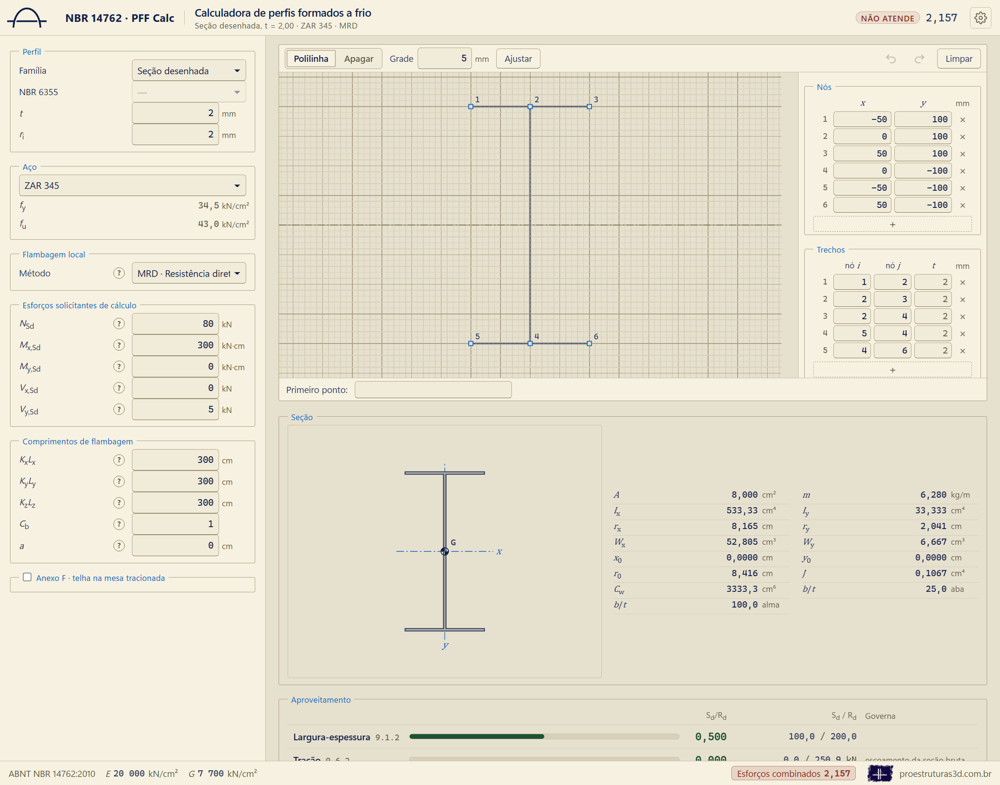

Com a família "Seção desenhada", o editor aparece no alto da coluna da direita. A seção é a linha média da chapa: nós ligados por trechos. Ao trocar de família, o editor já abre com o perfil que estava na tela, desenhado. Há três maneiras de desenhar, que podem ser misturadas à vontade:

1. **Clicando na grade.** No modo Polilinha, cada clique põe um nó e liga ao anterior. O ponto é puxado para a grade (o passo da grade é ajustável), para os nós existentes e para o alinhamento com eles, como o rastreamento do AutoCAD. Clicar no meio de um trecho existente parte o trecho em dois, que é como se faz um T. O botão direito, Enter ou espaço terminam a polilinha.
2. **Digitando coordenadas, como no CAD.** Na linha de comando, embaixo: `x,y` para a coordenada absoluta, `@dx,dy` para a relativa ao último ponto e `@L<ângulo` para a polar. Com ponto e vírgula entre x e y, a vírgula vale como decimal (`12,5;30`). `F` fecha a polilinha no primeiro nó, e Ctrl+Z desfaz.
3. **Pelas tabelas.** As tabelas de nós (x, y em milímetros) e de trechos (nó inicial, nó final e espessura) aceitam correção direta. Um trecho com espessura em branco usa a espessura t da seção.

Nas dobras (nós com dois trechos de mesma espessura), a calculadora arredonda o canto com o raio interno; nas junções de três ou mais trechos e onde a espessura muda, o canto é vivo. Quem é alma, mesa, aba ou enrijecedor sai da forma do desenho: o elemento de borda livre preso a uma mesa que se apoia na alma é enrijecedor; num U, as mesas livres são mesas.

### Dois Ue boca com boca

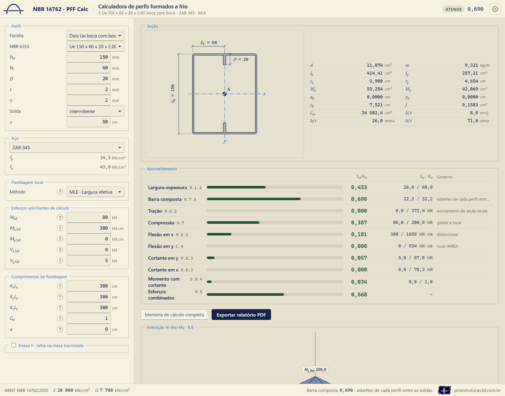

Com solda contínua, a área e os momentos de inércia são os dos dois Ue reais, e a torção (constante de torção e constante de empenamento) é a da célula fechada. Com solda intermitente, a flambagem local e a distorcional são as de cada perfil isolado, como mandam as notas das Tabelas 9 e 12, e a verificação da barra composta (9.7.5) entra no quadro.

## Como cada verificação é feita

### Propriedades da seção

As propriedades saem da linha média da chapa, com os cantos em arco de raio médio igual ao raio interno mais meia espessura, por integração exata trecho a trecho. As larguras planas b, que entram na flambagem local, descontam os cantos (9.2).

### Flambagem local pelos três métodos

- **Método da largura efetiva (MLE).** Cada elemento comprimido tem a sua largura efetiva pelas Tabelas 5 e 6 e pelo item 9.2.3 (mesa com enrijecedor de borda). Na flexão, a tensão de cada elemento é a da fibra mais comprimida dele, na face externa da chapa, como diz o item 9.2.2.1 a); a linha neutra da seção efetiva é iterada até parar de mudar.
- **Método da seção efetiva (MSE).** O coeficiente de flambagem local da seção inteira sai das Tabelas 10 e 13. Fora do campo de validade das tabelas, a calculadora usa o esforço crítico local das faixas finitas, que o próprio item permite.
- **Método da resistência direta (MRD, Anexo C).** As curvas do Anexo C com os esforços críticos elásticos das faixas finitas: o local, o distorcional e o global.

### Flambagem distorcional e a curva de assinatura

Os esforços críticos elásticos vêm de um método das faixas finitas implementado na própria calculadora. Para cada esforço (força normal, Mx e My), a calculadora calcula o esforço crítico em função do comprimento de meia-onda: é a **curva de assinatura**. O primeiro vale, de meia-onda curta, é a flambagem local; o vale seguinte, de meia-onda da ordem da largura da mesa, é a distorcional. A forma do modo decide quem é quem: no modo local as dobras não saem do lugar; no distorcional, a mesa gira com o enrijecedor em torno da dobra com a alma.

Quando a curva não faz vale distorcional (ele se funde com o local ou com o global), a calculadora toma o **ombro**: o primeiro ponto da curva, depois do vale local, em que as dobras passam a andar pelo menos metade do deslocamento máximo. É a leitura literal do item 9.7.3 e fica a favor da segurança.

As Tabelas 11 e 14 dispensam a verificação do distorcional quando o enrijecedor é suficiente; a dispensa vale no MLE e no MSE, e só com o enrijecedor a 90°, que é o que as figuras da Tabela 9 mostram. No MRD, o distorcional é sempre verificado.

### Barra com painel conectado à mesa tracionada (Anexo F)

Com o Anexo F ligado, o momento resistente da flexão em x, no sentido que traciona a mesa com a telha, é MRd = R·Wef·fy/γ, com γ = 1,10, o Wef do item 9.8.2.1 e o fator de redução R da Tabela F.1:

| Barra | Largura da alma | U enrijecido | Z enrijecido |
| --- | --- | --- | --- |
| Biapoiada | bw ≤ 165 mm | 0,70 | 0,70 |
| Biapoiada | 165 < bw ≤ 216 mm | 0,65 | 0,65 |
| Biapoiada | 216 < bw ≤ 292 mm | 0,40 | 0,50 |
| Contínua | bw ≤ 292 mm | 0,60 | 0,70 |

Pela nota "a" da tabela, na barra contínua com relação entre vãos adjacentes acima de 1,2, valem os fatores da barra biapoiada.

Antes de usar o R, a calculadora confere as condições do item F.1 que a seção e o aço dizem sozinhos: a) mesas com enrijecedor de borda, o que limita o anexo ao U enrijecido e ao Z enrijecido; b) bw ≤ 292 mm; c) 60 ≤ bw/t ≤ 170; d) 2,8 ≤ bw/bf ≤ 4,5; e) 16 ≤ b/t ≤ 43, com b a largura da parte plana da mesa; g) vão menor que 10 m; m) fy ≤ 410 MPa. As outras condições (f, h, i, j, k, l e o F.4) são as declaradas no bloco da tela. A memória lista cada condição conferida, com o valor e o limite.

O anexo vale só no sentido do momento que traciona a mesa com a telha: com a telha em cima, o momento negativo; com a telha embaixo, o positivo. No outro sentido, a mesa livre é a tracionada, o painel não segura a mesa comprimida, e a flexão é verificada pelo item 9.8.2, com os comprimentos informados. A flexão em y não muda com o anexo.

Se uma condição conferida falha, ou se uma condição declarada não está marcada, o anexo não se aplica (F.2), e a calculadora verifica a flexão pelo item 9.8.2, como se não houvesse painel. A memória diz qual condição falhou, e a verificação mostra a mesma nota.

Com o anexo aplicado, o R substitui a flambagem lateral com torção, mas a flambagem distorcional do item 9.8.2.3 continua verificada, e vale o menor dos dois momentos resistentes. No método da resistência direta, o lugar de Wef·fy/γ é tomado pelo momento resistente da flambagem local do Anexo C.

### Esforços combinados (9.9)

A interação da norma é linear: a força normal dividida pela resistência à força normal, mais o momento em x dividido pela resistência ao momento em x, mais o momento em y dividido pela resistência ao momento em y, não pode passar de 1. Cada resistência é a do sentido do esforço: compressão ou tração, momento positivo ou negativo.

### Decisões onde a norma é omissa ou admite mais de uma leitura

| Assunto | Decisão |
| --- | --- |
| Distorcional do Z simples e da cantoneira simples | Não se aplica (9.3): não têm enrijecedor de borda. |
| Tração, 9.6.2 c) | Verificada pela alínea b) com a área líquida igual à área bruta; acima de A·fu/1,65, a barra não atende, e a memória informa o produto Ct·An mínimo. |
| Z com KxLx maior que KyLy | Usa Ix no comprimento maior. |
| Força cortante sem alma paralela ao esforço | Fica "avaliar", fora do índice máximo. Na cantoneira, a aba entra como alma só no regime de escoamento, com o limite tomado com kv = 0,43, a favor da segurança. |
| Perfil fora dos limites da Tabela 4 | Não atende. |
| Mesa com enrijecedor de borda sob tensão variando (o momento em y do Ue e do Ze; a cartola com os enrijecedores comprimidos) | O método da largura efetiva não se aplica, porque o item 9.2.3 é só para elemento uniformemente comprimido. A calculadora passa para o método da resistência direta e diz isso na memória. |
| Z fletido em torno do eixo paralelo à alma (y) | A norma não traz o Me. Com Ix maior que Iy, o deslocamento para fora do plano é governado pelo eixo forte e a flambagem lateral com torção não comanda: a calculadora não reduz o momento e diz isso na memória. Com Iy maior ou igual a Ix, a verificação fica "avaliar", com o aviso. |
| Elemento com borda livre e tensão invertida (Tabela 6, casos c e d) | A parte tracionada é toda efetiva, e a largura efetiva da parte comprimida é ρ·bc, pela segunda expressão do 9.2.2.1. |
| Dois Ue com solda intermitente | A solda direta é tratada como presilha no item 9.7.5 a), a hipótese mais exigente. O item 9.8.6 (espaçamento máximo L/6) é escrito para o perfil I composto de dois U e não é aplicado à caixa. |
| Anexo F e a flambagem distorcional | O anexo não diz se a distorcional continua valendo. O R substitui a flambagem lateral com torção, a distorcional (9.8.2.3) continua verificada, e vale o menor, a favor da segurança. |
| Anexo F com uma condição não atendida | A norma (F.2) remete a ensaios ou a modelos semiempíricos, que a calculadora não faz. Ela verifica pelo item 9.8.2, sem a contribuição do painel, como o F.4 manda no balanço, e diz qual condição falhou. |
| Anexo F no método da resistência direta | O Wef·fy/γ do 9.8.2.1 é trocado pelo momento resistente da flambagem local do Anexo C, o análogo dele nesse método. |

## As janelas do (?)

Cada campo dos esforços e dos comprimentos tem um (?) que abre uma janela com a cena 3D correspondente: a barra flambando por flexão, por torção, a flambagem lateral com torção da viga, o diagrama do Cb e os esforços na barra. Nas cenas 3D, o botão esquerdo do mouse gira, o direito arrasta e a roda aproxima.

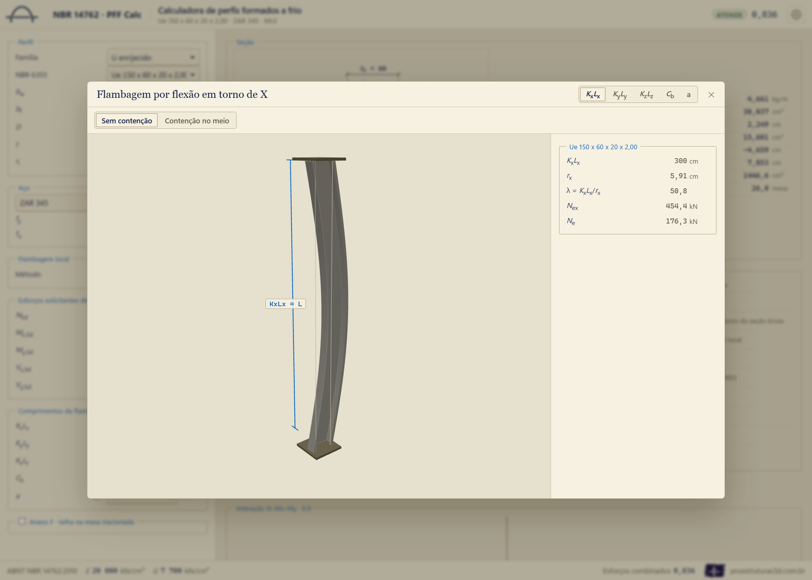

### Flambagem local e distorcional

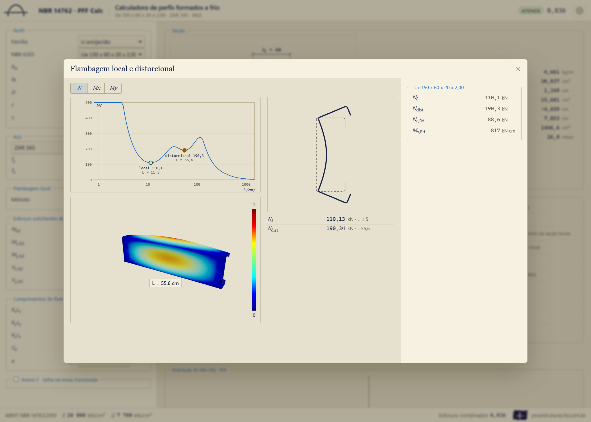

A janela do método da flambagem local mostra a curva de assinatura de cada esforço, com os vales marcados. Embaixo da curva, a barra aparece deformada pelo modo do ponto escolhido, em faixas coloridas pelo deslocamento normalizado (de 0 a 1), com a seção indeformada no começo e no fim de cada meia-onda. Clicar em qualquer ponto da curva mostra o modo daquele comprimento de meia-onda; clicar num vale mostra o modo do vale. A forma é a do próprio cálculo das faixas finitas, não um desenho ilustrativo.

### Diagrama de interação

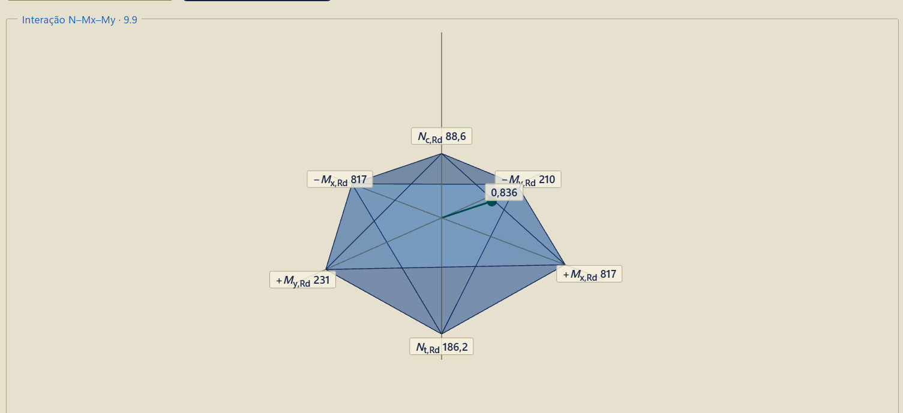

Embaixo dos resultados, a superfície de interação do item 9.9 em 3D: um poliedro de oito planos com vértices na resistência à compressão, à tração e aos momentos de cada sentido. Cada eixo está na sua escala, de modo que a assimetria de sinal (a resistência à compressão menor que a de tração; o My do Ue diferente nos dois sentidos) aparece na forma. O ponto solicitante é ligado à origem, e o raio continua tracejado até a superfície: o índice é a razão entre os dois comprimentos, o mesmo número da verificação de esforços combinados.

## A memória de cálculo e o PDF

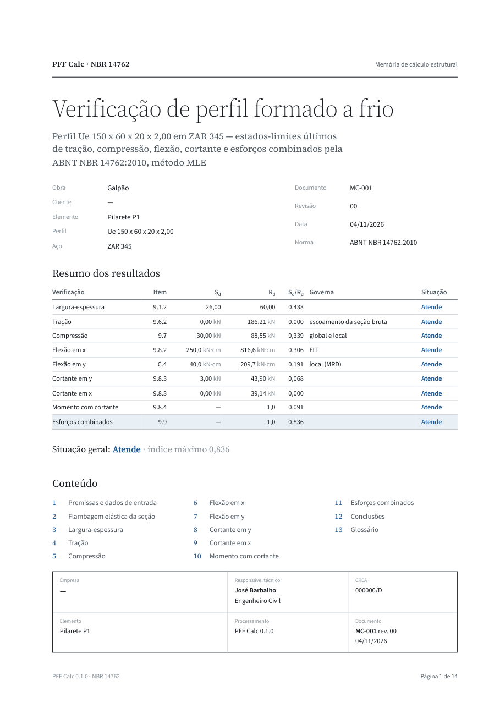

O botão "Memória de cálculo completa" abre a memória na tela, com os campos do carimbo ao lado: obra, cliente, elemento, documento, revisão e empresa. O responsável técnico, o título e o CREA não são digitados ali: vêm do projetista da configuração, na engrenagem, e o mesmo nome entra no carimbo da capa e no bloco de assinatura das conclusões. Sem projetista na configuração, o carimbo fica com um traço, e a assinatura fica em branco, com a linha para assinar.

"Exportar relatório PDF" gera o PDF em folha A4 e abre a caixa "Salvar como". No programa instalado, quem imprime é o próprio programa; na versão de navegador, o Edge da máquina.

A memória tem a capa com o resumo, as premissas e os dados de entrada (com o desenho da seção e as larguras planas), a flambagem elástica com as curvas de assinatura, um capítulo por verificação e as conclusões com a assinatura, e fecha com o glossário dos símbolos. Cada passo traz o item da norma à esquerda e, à direita, a fórmula literal, a mesma fórmula com os números no lugar das letras e o resultado. A conta e o texto saem do mesmo lugar: o número que aparece na memória é a mesma variável que entrou na conta.

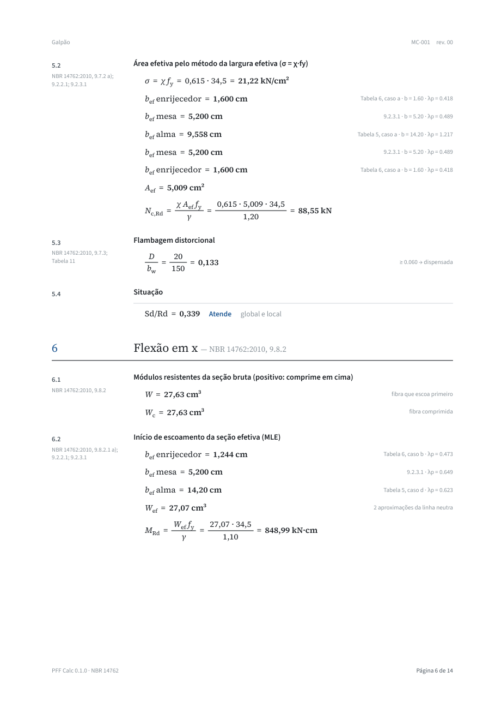

Com o Anexo F ligado, a flexão em x ganha o passo "Painel conectado à mesa tracionada", com as condições conferidas, o R da Tabela F.1 e o momento resistente.

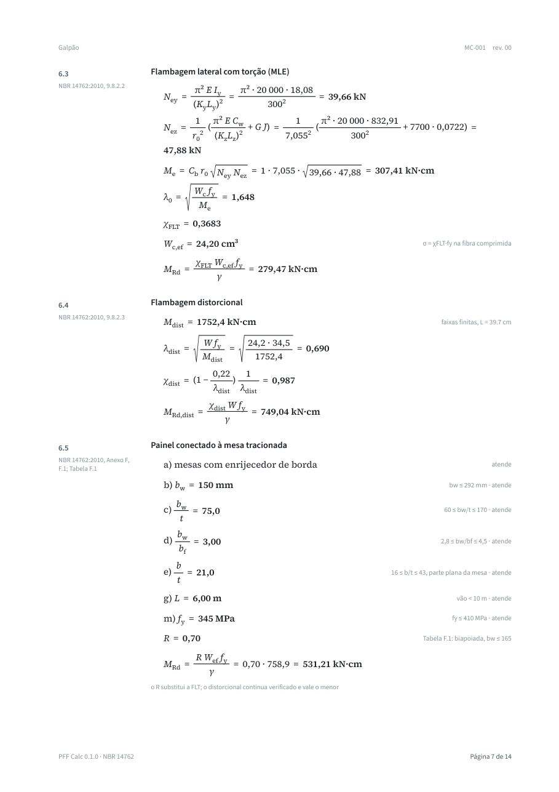

## Como a calculadora foi conferida

A calculadora foi conferida contra referências independentes em cada camada: as propriedades da seção, os esforços críticos elásticos e as resistências. Onde uma referência diverge da norma, vale a norma; nenhuma diferença foi escondida, e cada uma tem a causa escrita. As causas que se repetem levam um nome:

- **Distorcional pela tabela de Pierin.** O DimPerfil tira o esforço crítico distorcional de uma tabela pré-calculada (Pierin et al., 2013), montada com canto vivo e com as dimensões nominais na linha média da chapa: a seção dele fica uma espessura maior em cada direção que o perfil real. O distorcional da calculadora, com a seção real, sai 2 a 4 % menor. Fora do catálogo, a tabela não tem o valor e o DimPerfil não verifica o distorcional.
- **Tensão na face.** Na largura efetiva em flexão, a calculadora toma a tensão da mesa comprimida na face externa da chapa, como diz o item 9.2.2.1 a) ("a máxima tensão de compressão"); o DimPerfil a toma na linha média. A diferença é de 0,1 a 0,4 % no módulo efetivo, a favor da segurança.
- **Duas cordas no canto.** Para a constante de torção, a constante de empenamento e a posição do centro de torção, o DimPerfil troca cada canto em arco por duas cordas; aqui o arco é integrado exato. A diferença é de 0,1 a 0,4 % nessas grandezas.
- **Cartola deitada.** O DimPerfil desenha a cartola com o eixo de simetria horizontal: o momento em x dele é o momento em y da calculadora, e o cortante dele é o cortante em x da calculadora. O D dele inclui a espessura da parede.
- **Z principal contra o geométrico.** Com os eixos principais ligados, o DimPerfil flete o Z em torno do eixo principal; com eles desligados, calcula o momento crítico de flambagem lateral com torção com o momento de inércia do eixo geométrico, o que a norma não prevê (9.7.2.1 manda o eixo principal) e deixa o Me até 57 % maior.
- **Wxef menor nas almas altas.** Na alma sob flexão (Tabela 5, caso d), a norma calcula a largura efetiva bef com a largura inteira da alma e a divide em bef1 = bef/(3 − ψ) e bef2 = 0,5·bef, até o limite da parte comprimida bc. O DimPerfil desconta a parte tracionada do bef antes de dividir, e com isso tira quase toda a parte comprimida das almas esbeltas. O efeito aparece acima de h/t ≈ 80 e cresce com a esbeltez da alma. No pior caso do lote, o U 300x107x1,5 (h/t = 196, logo abaixo do limite de 200 da Tabela 4), o relatório dele mostra bef = 14,822 cm e uma parte comprimida efetiva de 0,12 cm; a conta à mão pela norma dá Wef = 24,09 cm³, a calculadora 24,10 e o DimPerfil 13,68. As conferências às cegas do Ue 300x85x25x2,00 e do Ze 200x75x20x2,25 deram o valor da calculadora até a oitava casa.
- **Mesa enrijecida sob tensão variando.** No momento em y do Ue e do Ze, e na cartola com os enrijecedores comprimidos, a mesa com enrijecedor de borda fica sob tensão variando, e o item 9.2.3 só vale para elemento uniformemente comprimido. A calculadora passa para o método da resistência direta; o DimPerfil aplica o método da largura efetiva mesmo assim. Os dois métodos dão valores diferentes, nos dois sentidos.
- **Borda livre com tensão invertida.** Num elemento com borda livre e tensão de sinais opostos (Tabela 6, casos c e d: a mesa do U no momento em y, as abas da cantoneira), a norma considera a parte tracionada toda efetiva e toma a largura efetiva da parte comprimida, ρ·bc (9.2.2.1, segunda expressão). O DimPerfil toma ρ·b com a largura inteira e o põe junto à borda comprimida. Conforme a geometria, a calculadora fica acima ou abaixo dele.
- **Me do Z em y.** A norma não traz o momento crítico de flambagem lateral com torção do Z fletido em torno do eixo y, o eixo paralelo à alma. Fletido assim, o deslocamento para fora do plano do carregamento é governado pelo Ix, o eixo forte, e a flambagem lateral com torção não comanda, como no perfil I fletido no eixo de menor inércia; por isso a calculadora não reduz o momento. Essa leitura vale com Ix maior que Iy: num Z de mesa larga, com Iy maior ou igual a Ix, a calculadora não verifica a flambagem lateral com torção e marca a verificação como "avaliar", com o aviso na memória. O DimPerfil aplica o Anexo E. O momento resistente final, comandado pelo escoamento, sai igual nos dois.
- **Fibra que escoa primeiro na seção efetiva.** Na cartola fletida em torno do eixo de simetria, os dois programas escolhem fibras diferentes para o início do escoamento da seção efetiva; a diferença é de até 3 %.

### Protótipo em Python do engenheiro

| Perfil | Grandeza | Calculadora | Oráculo | Diferença | Causa |
| --- | --- | --- | --- | --- | --- |
| 9 perfis, canto vivo | A, Ix, Iy, x0, y0, J, Cw | — | — | ≤ 1e−12 | — |
| 9 perfis, mesma malha | esforços críticos elásticos, todas as cargas, até 3 m | — | — | ≤ 1e−8 | — |

### pyCUFSM (o CUFSM em Python)

| Perfil | Grandeza | Calculadora | Oráculo | Diferença | Causa |
| --- | --- | --- | --- | --- | --- |
| 1 060 perfis do catálogo | 7 020 mínimos da curva de assinatura | — | — | ≤ 1,2e−7 | — |
| Tubo fechado dos dois Ue | curva de assinatura | — | — | ≤ 4,7e−7 | — |

O CUFSM original (MATLAB) não foi rodado: o pyCUFSM é a tradução dele em Python, com o mesmo método. A classificação automática dos modos do pyCUFSM (cFSM) está com defeito na versão usada e não serviu de juiz; a classificação da calculadora foi conferida contra os rótulos da tabela de Pierin, com 99 % de concordância.

### Relatórios do DimPerfil rodados pelo engenheiro

Aço ZAR 345, rm = 1,5t, Cb = 1, comprimento igual nas três direções, método da largura efetiva. Forças em kN, momentos em kN·cm.

| Perfil | Grandeza | Calculadora | DimPerfil | Diferença | Causa |
| --- | --- | --- | --- | --- | --- |
| Ue 150x60x20x2,00 | A (cm²) | 5,937 | 5,937 | 0 | — |
| Ue 150x60x20x2,00 | Cw (cm⁶) | 1 446,61 | 1 440,47 | +0,4 % | — |
| Ue 150x60x20x2,00, KL 150 | Ne | 206,38 | 206,01 | +0,18 % | — |
| Ue 150x60x20x2,00, KL 150 | Nc,Rd | 94,06 | 94,0 | +0,06 % | — |
| Ue 150x60x20x2,00, KL 150 | Mx,esc | 848,99 | 851,15 | −0,25 % | — |
| Ue 150x60x20x2,00, KL 150 | Mx,Rd (FLT) | 816,60 | 818,65 | −0,25 % | — |
| Ue 150x60x20x2,00, KL 150 | Mdist | 1 791,4 | 1 845 | −2,9 % | distorcional pela tabela de Pierin |
| Ue 150x60x20x2,00, KL 150 | VRd | 43,90 | 43,9 | 0 | — |
| U 100x50x2,00, KL 150 | Nc,Rd | 40,38 | 40,3 | +0,2 % | — |
| U 100x50x2,00, KL 150 | Mx,Rd (FLT) | 231,69 | 232,48 | −0,34 % | — |
| U 100x50x2,00, KL 150 | My,Rd (pontas comprimidas) | 40,25 | 38,64 | +4,2 % | borda livre com tensão invertida |
| U 100x50x2,00, KL 150 | VRd | 34,63 | 34,63 | 0 | — |
| Ze 200x75x20x2,25, KL 200 | Nc,Rd | 105,55 | 105,58 | −0,03 % | — |
| Ze 200x75x20x2,25, KL 200 | Ndist | 184,32 | 195,13 | −5,5 % | distorcional pela tabela de Pierin |
| Ze 200x75x20x2,25, KL 200 | Mx,esc | 1 462,45 | 1 300,05 | +12,5 % | Wxef menor nas almas altas |
| Ze 200x75x20x2,25, KL 200 | Me | 1 305,89 | 2 047,57 | −36 % | Z principal contra o geométrico |
| Ze 200x75x20x2,25, KL 200 | VRd | 49,06 | 49,06 | 0 | — |
| Cr 100x50x20x2,00, KL 150 | Nc,Rd | 18,70 | 18,64 | +0,3 % | — |
| Cr 100x50x20x2,00, KL 150 | Mx,Rd (enrijecedores comprimidos) | 130,41 | 129,78 | +0,5 % | cartola deitada |
| Cr 100x50x20x2,00, KL 150 | My,Rd | 177,15 | 215,19 | −17,7 % | cartola deitada; o distorcional da calculadora governa, e o DimPerfil não o tem na tabela |
| L 60x60x3,00, KL 150 | Nc,Rd | 30,33 | 30,41 | −0,26 % | — |
| Dois Ue 300x100x25x2,65 (caixa), KL 150 | A · Ix | 28,227 · 3 832,56 | 28,23 · 3 831,59 | 0 | — |
| Dois Ue 300x100x25x2,65 (caixa), KL 150 | Iy | 1 856,15 | 1 910,91 | −2,9 % | ele deixa uma folga de uma espessura entre os enrijecedores |
| Dois Ue 300x100x25x2,65 (caixa), KL 150 | Mx,Rd,dist | 6 320,7 | 4 912,4 | +29 % | ele compara o momento da caixa com o distorcional de um Ue só |

### A bancada em lote do DimPerfil

O DimPerfil foi rodado sem janela, pelas próprias rotinas de cálculo dele, sobre 642 seções: o catálogo inteiro da NBR 6355 (menos o Ze 45°) e seções livres com bw, bf, D, t e o comprimento variando. A bancada foi conferida primeiro contra os relatórios acima: todos os resultados finais nos eixos geométricos saíram iguais até a segunda casa. A tabela mostra a razão entre o valor da calculadora e o do DimPerfil (mediana e faixa de 90 % dos casos) e a fração dos casos dentro de 2 %. O distorcional e os resultados finais que ele pode comandar só entram onde o DimPerfil tem tabela.

| Grandeza | Família | Casos | Mediana | 5 % a 95 % | Dentro de ±2 % | Causa |
| --- | --- | --- | --- | --- | --- | --- |
| Nc,Rd sem distorcional (MLE) | U | 148 | 1,000 | 0,994 a 1,002 | 100 % | — |
| Nc,Rd sem distorcional (MLE) | Ue | 85 | 1,000 | 0,998 a 1,002 | 100 % | — |
| Nc,Rd sem distorcional (MLE) | Z | 148 | 0,998 | 0,986 a 1,000 | 99 % | — |
| Nc,Rd sem distorcional (MLE) | Ze | 60 | 0,999 | 0,996 a 1,000 | 100 % | — |
| Nc,Rd sem distorcional (MLE) | Cr | 15 | 1,004 | 0,998 a 1,007 | 100 % | — |
| Nc,Rd sem distorcional (MLE) | L | 23 | 0,999 | 0,990 a 1,000 | 100 % | — |
| Nc,Rd | Ue | 75 | 1,000 | 0,995 a 1,002 | 97 % | — |
| Nc,Rd | Ze | 57 | 0,999 | 0,983 a 1,000 | 96 % | — |
| Nc,Rd distorcional | Ue | 51 | 0,984 | 0,956 a 1,000 | 57 % | distorcional pela tabela de Pierin |
| Nc,Rd distorcional | Ze | 46 | 0,978 | 0,950 a 1,000 | 46 % | distorcional pela tabela de Pierin |
| Mx,Rd escoamento | U | 148 | 0,997 | 0,993 a 1,305 | 83 % | Wxef menor nas almas altas |
| Mx,Rd escoamento | Ue | 85 | 1,000 | 0,996 a 1,257 | 79 % | Wxef menor nas almas altas |
| Mx,Rd escoamento | Z | 148 | 0,997 | 0,993 a 1,300 | 88 % | Wxef menor nas almas altas |
| Mx,Rd escoamento | Ze | 60 | 1,000 | 0,997 a 1,327 | 80 % | Wxef menor nas almas altas |
| Mx,Rd escoamento | Cr | 15 | 1,000 | 0,988 a 1,000 | 100 % | — |
| Mx,Rd escoamento | L | 23 | 1,016 | 0,919 a 1,063 | 35 % | borda livre com tensão invertida |
| Mx,Rd FLT | U | 148 | 0,998 | 0,994 a 1,248 | 91 % | Wxef menor nas almas altas |
| Mx,Rd FLT | Ue | 85 | 1,001 | 0,996 a 1,214 | 87 % | Wxef menor nas almas altas |
| Mx,Rd FLT | Z | 148 | 0,712 | 0,578 a 1,048 | 3 % | Z principal contra o geométrico |
| Mx,Rd FLT | Ze | 60 | 0,751 | 0,573 a 1,180 | 7 % | Z principal contra o geométrico |
| Mx,Rd FLT | Cr | 15 | 1,001 | 0,998 a 1,024 | 93 % | fibra que escoa primeiro na seção efetiva |
| Mx,Rd distorcional | Ue | 83 | 1,000 | 0,986 a 1,000 | 100 % | — |
| Mx,Rd distorcional | Ze | 59 | 1,000 | 0,985 a 1,000 | 97 % | — |
| Mx,Rd | Ue | 85 | 1,001 | 0,989 a 1,151 | 87 % | Wxef menor nas almas altas |
| Mx,Rd | Ze | 60 | 0,751 | 0,573 a 1,117 | 7 % | Z principal contra o geométrico |
| My,Rd escoamento | U | 148 | 1,004 | 0,975 a 1,050 | 67 % | borda livre com tensão invertida |
| My,Rd escoamento | Ue | 85 | 0,998 | 0,508 a 1,485 | 33 % | mesa enrijecida sob tensão variando |
| My,Rd escoamento | Z | 148 | 0,995 | 0,991 a 0,998 | 99 % | — |
| My,Rd escoamento | Ze | 60 | 0,999 | 0,998 a 1,309 | 75 % | mesa enrijecida sob tensão variando |
| My,Rd escoamento | Cr | 15 | 0,461 | 0,199 a 1,329 | 0 % | mesa enrijecida sob tensão variando |
| My,Rd escoamento | L | 23 | 1,006 | 0,918 a 1,032 | 57 % | borda livre com tensão invertida |
| My,Rd FLT | U | 148 | 1,005 | 0,978 a 1,050 | 65 % | borda livre com tensão invertida |
| My,Rd FLT | Ue | 85 | 0,999 | 0,997 a 1,497 | 72 % | mesa enrijecida sob tensão variando |
| My,Rd FLT | Z | 148 | 0,999 | 0,980 a 1,032 | 86 % | Me do Z em y |
| My,Rd FLT | Ze | 60 | 1,000 | 0,998 a 1,380 | 65 % | mesa enrijecida sob tensão variando |
| My,Rd FLT | Cr | 15 | 1,002 | 1,001 a 1,593 | 87 % | mesa enrijecida sob tensão variando |
| My,Rd | U | 148 | 1,005 | 0,978 a 1,050 | 65 % | borda livre com tensão invertida |
| My,Rd | Ue | 85 | 0,999 | 0,997 a 1,387 | 72 % | mesa enrijecida sob tensão variando |
| My,Rd | Z | 148 | 0,995 | 0,991 a 0,998 | 98 % | — |
| My,Rd | Ze | 60 | 1,000 | 0,998 a 1,159 | 67 % | mesa enrijecida sob tensão variando |
| My,Rd | Cr | 15 | 1,002 | 1,001 a 1,593 | 87 % | mesa enrijecida sob tensão variando |
| My,Rd | L | 23 | 1,006 | 0,918 a 1,032 | 57 % | borda livre com tensão invertida |
| VRd | U | 148 | 1,000 | 1,000 a 1,000 | 100 % | — |
| VRd | Ue | 153 | 1,000 | 1,000 a 1,000 | 100 % | — |
| VRd | Z | 148 | 1,000 | 1,000 a 1,000 | 100 % | — |
| VRd | Ze | 83 | 1,000 | 1,000 a 1,000 | 100 % | — |
| VRd | Cr | 65 | 1,000 | 0,998 a 1,000 | 100 % | — |
| VRd | L | 3 | 1,000 | 1,000 a 1,000 | 100 % | — |
| VRd | Le | 22 | 1,000 | 1,000 a 1,000 | 100 % | — |

Em resumo, por grandeza:

- **Onde batem** (dentro de 2 % em quase todos os casos): a compressão sem o distorcional em todas as famílias; o distorcional em flexão onde há tabela; o momento em y do Z; a força cortante em todas as famílias.
- **Onde a calculadora fica abaixo do DimPerfil:** o distorcional em compressão (de 2 a 4 %, e mais nos perfis sem vale distorcional) e a flambagem lateral com torção do Z (até 42 % abaixo). Nos dois casos, a calculadora segue a norma: a seção real no distorcional, e o eixo principal no Ney do Z (9.7.2.1 b).
- **Onde a calculadora fica acima do DimPerfil:** o momento de escoamento em x nas almas com h/t acima de uns 80, até 41 % no catálogo e até 76 % nas chapas muito finas das seções livres. A calculadora segue a Tabela 5 da norma, e o DimPerfil desconta a parte tracionada da alma antes de dividir a largura efetiva; duas conferências às cegas e a conta à mão do pior caso deram o valor da calculadora.
- **Onde os dois usam métodos diferentes:** o momento em y do Ue e do Ze e o da cartola com os enrijecedores comprimidos. Ali a mesa enrijecida fica sob tensão variando, fora do campo do método da largura efetiva (9.2.3). A calculadora passa para o método da resistência direta, como está na tabela de decisões do capítulo 4 (mesa enrijecida sob tensão variando), e o DimPerfil aplica o método da largura efetiva mesmo assim.
- **Onde a diferença vai para os dois lados:** o momento em y do U e os momentos da cantoneira, pela leitura do elemento com borda livre e tensão invertida. A calculadora segue a segunda expressão do 9.2.2.1, com a parte tracionada toda efetiva.

Na tabela, o momento em y do U, do Ue e da cantoneira é o das pontas das mesas comprimidas: o DimPerfil calcula só esse sentido.

Em 166 dos 642 casos o DimPerfil não devolveu a resistência à compressão. Todos são seções com enrijecedor de borda (Ue, Ze, cartola e cantoneira enrijecida) que não estão na tabela de Pierin, a maioria seções livres: sem o distorcional da tabela, ele não fecha a compressão. A calculadora calcula esses casos, com o distorcional das faixas finitas, mas não há com o que comparar.

### Conferências às cegas

Uma conta independente, feita só com o texto da norma e sem acesso ao programa, recebeu como dado apenas as propriedades e os esforços críticos das faixas finitas.

| Perfil | Grandeza | Calculadora | Conta às cegas | Diferença | Causa |
| --- | --- | --- | --- | --- | --- |
| Ue 150x60x20x2,00, KL 300/150/150 | Nc,Rd (MLE) | 88,55 | 88,55 | 0 | — |
| Ue 150x60x20x2,00 | Wef em Mx | 27,069 | 27,069 | 0 | — |
| Ue 150x60x20x2,00 | Mx,Rd (FLT) | 816,60 | 816,60 | 0 | — |
| Dois Ue 300x100x25x2,65, solda a cada 30 cm | Nc,Rd (distorcional) | 406,33 | 406,33 | 0 | — |
| Dois Ue 300x100x25x2,65, solda a cada 30 cm | Mx,Rd (distorcional) | 6 320,74 | 6 320,74 | 0 | — |
| Ue 300x85x25x2,00 | Wef em Mx | 74,5349 | 74,5349 | 0 | — |
| Ze 200x75x20x2,25 (eixo geométrico) | Wef em Mx | 46,6289 | 46,6289 | 0 | — |

### Selos do Anexo F

Os selos são casos fixos que rodam a cada mudança do programa e não deixam um resultado mudar sem aviso. Para o Anexo F, há um perfil em cada linha da Tabela F.1, todos em aço ZAR 345, com o momento negativo (a mesa de cima, com a telha, tracionada), vão de 6 m, KyLy = KzLz = 600 cm e o método da largura efetiva. Momentos em kN·cm.

| Perfil | Barra | R | R·Wef·fy/γ | MRd,dist | MRd com o anexo | MRd pelo 9.8.2 |
| --- | --- | --- | --- | --- | --- | --- |
| Ue 150x50x17x2,00 | biapoiada | 0,70 | 531,2 | 749,0 | 531,2 | 91,1 |
| Ue 200x70x20x2,25 | biapoiada | 0,65 | 948,7 | 1 393,4 | 948,7 | 283,9 |
| Ue 250x85x25x2,25 | biapoiada | 0,40 | 870,3 | 2 016,2 | 870,3 | 603,5 |
| Ze 250x85x25x2,25 | biapoiada | 0,50 | 1 087,8 | 2 013,3 | 1 087,8 | 279,6 |
| Ue 200x70x20x2,25 | contínua | 0,60 | 875,7 | 1 393,4 | 875,7 | 283,9 |
| Ze 200x70x20x2,25 | contínua | 0,70 | 1 021,7 | 1 391,9 | 1 021,7 | 128,4 |
| Ue 200x70x20x2,25 | contínua, vãos 1,3 | 0,65 | 948,7 | 1 393,4 | 948,7 | 283,9 |

Na última linha, a nota "a" troca o fator da contínua pelo da biapoiada; com a relação exatamente igual a 1,2, o fator continua o da contínua. Nos sete casos, a distorcional fica acima do R e não governa, e o selo confere que o momento resistente é o menor dos dois.

Os outros selos fazem o anexo sair, e em todos eles o momento resistente volta a ser exatamente o do 9.8.2, com a condição escrita na nota:

- cada condição conferida falhando sozinha: a) o U simples 150x50x2,00; b) o Ue 300x100x25x2,65, com bw acima de 292 mm; c) o Ue 150x50x17x3,00, com bw/t = 50; d) o Ue 200x90x20x2,25, com bw/bf = 2,22; e) o Ue 250x85x25x1,50, com a mesa fina; g) o vão de 10 m; m) o aço com fy = 450 MPa;
- uma condição declarada desmarcada (os conectores, j) e o F.4 desmarcado; o traspasse (f) só conta na barra contínua;
- o momento no sentido que comprime a mesa com a telha, que volta ao 9.8.2; e, com a telha embaixo, o anexo valendo no momento positivo;
- a flexão em y, que não muda com o anexo;
- a memória, com o passo do anexo e, quando ele não se aplica, com a condição que falhou.

### Revisões independentes

Dois revisores independentes, um pela norma e outro pelo programa, e um juiz separando defeito real de falso alarme: 19 achados, 13 reais e corrigidos com teste, o resto decisão do engenheiro ou leitura registrada.

### O que nenhum oráculo cobriu

- A seção desenhada com ramificação ou com célula fechada, nas resistências: as propriedades e as faixas finitas foram conferidas contra fórmulas fechadas e contra o pyCUFSM, mas nenhum programa externo verificou a resistência de um I ou de uma caixa desenhada.
- Os dois Ue com solda contínua no método da resistência direta, com a nervura soldada: nenhum programa externo modela a nervura.
- O Ze com enrijecedor a 45°: o DimPerfil calcula a área e as inércias por outro caminho, que não é a geometria que ele mesmo desenha, e o caso ficou fora do lote.
- O My negativo do U, do Ue e da cantoneira (alma comprimida), que o DimPerfil não calcula.
- A cantoneira fletida nos eixos principais, que esta versão não verifica.

## Perguntas frequentes

### Por que o resultado difere do DimPerfil?

Na maior parte dos casos, por uma das causas listadas no capítulo anterior: a tabela de distorcional que o DimPerfil usa, a tensão na face da chapa, o modelo do canto e a leitura da cartola. A memória de cálculo mostra cada passo e permite localizar a diferença.

### Posso usar a calculadora para a terça com a telha presa na mesa tracionada?

Sim, pelo Anexo F: ligue o bloco "Anexo F", embaixo dos comprimentos, escolha a mesa com a telha, a barra biapoiada ou contínua e o vão, e marque as condições que a obra atende. No sentido do momento que traciona a mesa com a telha, o momento resistente sai pelo fator R da Tabela F.1; no outro sentido, e quando alguma condição não é atendida, a verificação é a do item 9.8.2, com o comprimento que o engenheiro informar.

### O Anexo F está ligado, mas a flexão saiu pelo 9.8.2. Por quê?

Por uma de três razões: uma condição conferida não passou (a memória diz qual, com o valor e o limite), uma condição declarada não está marcada, ou o momento está no sentido que comprime a mesa com a telha. A nota da verificação da flexão em x diz qual delas.

### Onde mudo o nome que sai na assinatura da memória?

Na engrenagem do canto superior direito, em Projetista: nome, título e CREA. O carimbo e a assinatura da memória passam a sair com esses dados.

### O que significa "avaliar" no quadro?

A verificação foi feita, mas há uma ressalva que pede o olho do engenheiro, ou a norma não traz a conta do caso (por exemplo, a força cortante sem alma paralela ao esforço). "Avaliar" não reprova o perfil, e a memória diz o motivo.

### O desenho da seção recusou o que eu desenhei. Por quê?

A mensagem aparece na barra do editor. Os casos mais comuns são um nó sem trecho, um trecho curto demais para o raio de dobramento e dois trechos que se cruzam sem um nó no encontro.

### Os esforços entram com que sinal?

Força normal positiva comprime. Momento positivo comprime o lado positivo do eixo perpendicular: Mx positivo comprime a mesa de cima, e My positivo comprime o lado das pontas das mesas no U e no Ue.

### Por que a calculadora usou o MRD se eu escolhi o MLE?

Porque o MLE não se aplica àquela seção (a seção desenhada e a nervura soldada dos dois Ue). A memória diz isso no capítulo da verificação.

Dúvidas, críticas ou sugestões: encaminhar e-mail para contato@proestruturas3d.com.br
